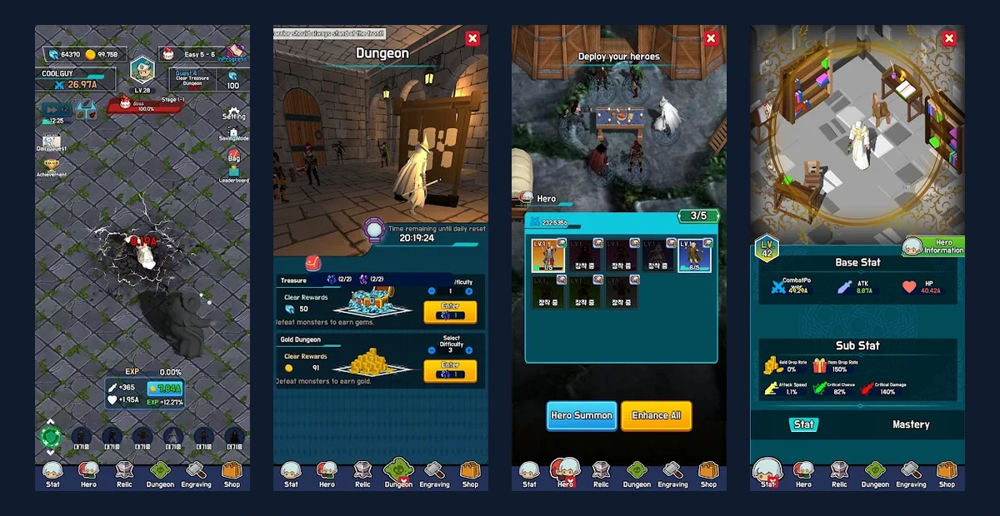
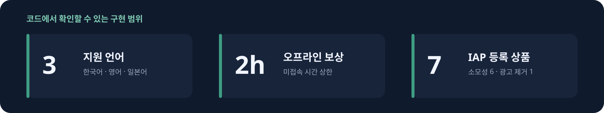
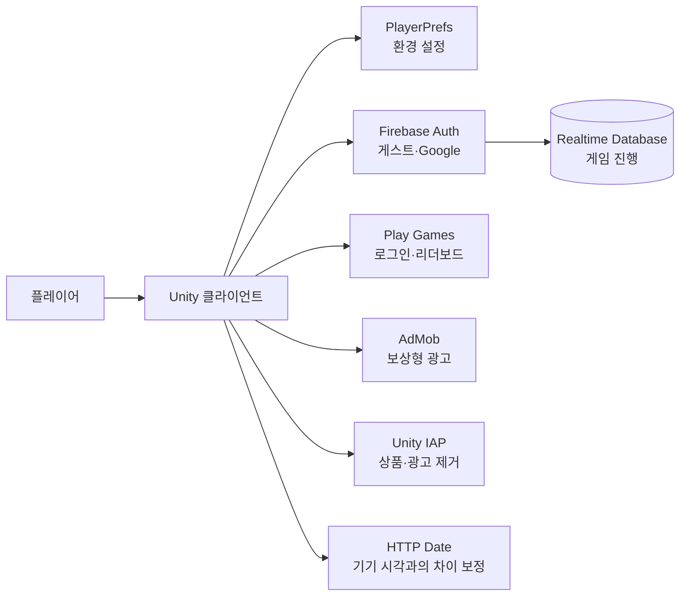
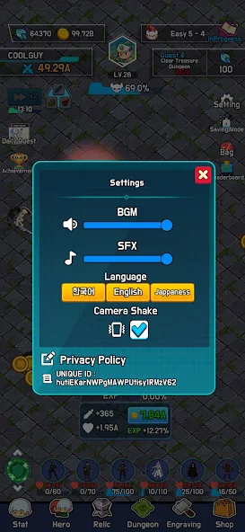
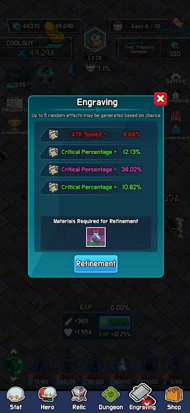
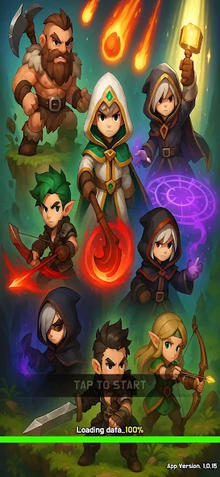
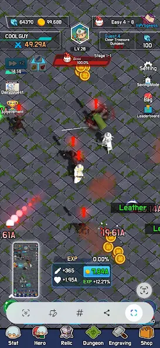

# 사제의 길: 낮과 밤

Unity와 C#으로 방치형 RPG를 혼자 개발해 Google Play에 출시했습니다. 전투와 성장 기능을 만들고, 로그인·진행 저장·광고·결제를 연결한 뒤 Android SDK 변경과 회원 탈퇴 기능을 업데이트했습니다.

<p>
  
  
  
  
  
  
  
</p>

[Google Play](https://play.google.com/store/apps/details?id=com.KHS.MonsterRaidIdle) · [플레이 영상](https://youtu.be/jKvEW6LIzaw)



## 프로젝트 요약

| 구성 | 담당 | 결과물 |
| --- | --- | --- |
| 1인 개발 | 기획, Unity C# 클라이언트, Firebase·Google 서비스, Play 배포 | Android · Google Play 출시 |



구현 수치는 공개한 코드를 기준으로 적었습니다.

## 맡은 일

- 전투, 성장, 영웅·유물, 던전, 퀘스트, 오프라인 보상 구현
- 게스트·Google 로그인과 Firebase Realtime Database 저장 구조 구현
- Google Play Games 리더보드, AdMob 보상형 광고, Unity IAP 연동
- 한국어·영어·일본어 CSV 로컬라이징과 기기 언어 적용
- AAB 빌드, Google Play 등록, SDK·계정 삭제 정책 대응

## 구조와 기술 선택



| 선택 | 이유 |
| --- | --- |
| Firebase Auth + Realtime Database | 로그인 유형을 나누고 사용자 UID 기준으로 진행 데이터를 저장 |
| PlayerPrefs | BGM, 효과음, 언어처럼 기기 안에 둘 설정을 서버 데이터와 분리 |
| HTTP Date 기반 시각 | 응답 시각과 기기 시각의 차이를 보정하고 낮·밤, 일일 초기화, 미접속 판정에서 함께 사용 |
| Queue 기반 오브젝트 풀 | 전투 중 반복 생성되는 몬스터, 아이템, 코인을 회수해 다시 사용 |
| CSV 로컬라이징 | UI 코드와 문구를 분리하고 같은 키로 3개 언어를 조회 |

## 출시 이후 수정한 부분

### 1. Android SDK 의존성을 정리하고 로그인 경로를 맞췄습니다

Target SDK와 16KB 페이지 크기에 대응하면서 Firebase, Google Play Games, Mobile Ads의 Android 의존성이 겹쳤습니다. 기존 Google Sign-In 플러그인도 남아 있어 빌드 오류와 로그인 경로를 함께 확인했습니다.

빌드할 때 생성되는 Gradle 파일에만 수정 사항을 남기면 다음 빌드에서 사라지므로 Unity 프로젝트의 SDK 구성을 정리했습니다. Unity 6000.0.76f1과 Target SDK 35를 기준으로 버전을 맞추고, Google Sign-In 플러그인과 중복 네이티브 라이브러리를 제거했습니다. 로그인은 Play Games에서 받은 서버 인증 코드로 Firebase에 연결하도록 바꿨습니다.

### 2. 회원 탈퇴를 재인증부터 데이터 삭제까지 순서대로 처리했습니다

Firebase Auth 계정과 Realtime Database의 진행 데이터는 각각 삭제해야 했습니다. Google 계정은 최근 인증이 없으면 계정 삭제 요청이 실패하므로, Play Games에서 인증 코드를 다시 받아 Firebase 재인증을 먼저 하도록 했습니다.

재인증 후 진행 데이터, 인증 계정, 기기 설정 순서로 삭제하고 각 단계가 실패하면 오류를 반환하도록 했습니다. 앱 안의 삭제 버튼과 웹 삭제 안내 페이지도 마련했습니다.

다만 DB 삭제 후 Auth 삭제가 실패했을 때 앞 단계까지 되돌리는 처리는 없습니다. 삭제 순서와 오류 전달을 구현한 범위입니다.

```text
재인증 → USER/{uid} 삭제 → Auth 계정 삭제 → 로그아웃 → PlayerPrefs 초기화
```

### 3. 낮·밤과 미접속 보상이 사용할 시간 기준을 모았습니다

낮·밤 전투, 일일 초기화, 미접속 보상이 같은 시각을 사용하도록 `Timer_NTP`에 시간 계산을 모았습니다. 실행 시 HTTP 응답의 `Date` 헤더(RFC1123)를 읽어 서버 UTC와 기기 UTC의 차이를 저장하고, 화면과 일일 초기화에는 이 시각을 기기 시간대로 바꿔 사용합니다. 오프라인 보상은 최대 2시간으로 제한했습니다.

출시 후 코드를 다시 보면서 시간 처리 문제를 고쳤습니다.

- 시스템 언어로 지역을 추측해 시간을 빼던 보정을 없앴습니다. 영어를 쓰는 다른 나라 사용자의 날짜가 어긋났습니다.
- 날짜를 기기 지역 형식 문자열로 저장해 언어가 바뀌면 읽지 못할 수 있었습니다. UTC ISO-8601로 저장하고, 이전 형식도 읽도록 했습니다.
- 일일 초기화가 날짜의 일(Day)만 비교해 1월 5일과 2월 5일 사이에는 초기화되지 않았습니다. 날짜 전체를 비교합니다.
- 오프라인 시간을 `접속 시각 - EndDate`로 계산했는데, 자동 저장이 `EndDate`를 계속 갱신해 보상 창이 늦게 열리면 음수가 되어 골드가 줄었습니다. 접속할 때 읽은 마지막 종료 시각으로 한 번만 계산하고, 음수는 0으로 처리합니다.

서버 시간과의 차이를 쓰기 때문에 실행 중에 기기 시계를 바꿔도 게임 시각은 바뀌지 않습니다. 기기 시간대 변경이나 보상 위변조를 서버에서 검증하는 단계까지 구현하지는 않았습니다.

### 4. 능력치와 보상 지급 경로를 다시 확인했습니다

전체 코드를 다시 읽으면서 능력치 계산과 보상 지급에서 값이 어긋나는 경로를 고쳤습니다.

- 영웅·유물 패시브를 장착할 때 더하고 해제할 때 빼는 방식이라, 재접속하면 보너스가 빠지고 드래그로 자리를 바꾸거나 유물을 고르기만 해도 보너스가 쌓였습니다. 지금은 장착 상태를 기준으로 매번 다시 계산합니다. 체력 계산에 공격력 보너스를 쓰던 오류와 전투력 표시에서 보너스를 두 번 곱하던 부분도 고쳤습니다.
- 소환·각인 결과를 연출하면서 하나씩 지급해, 연출 중 뒤로 가기로 창을 닫으면 다이아만 빠지고 결과 일부가 사라졌습니다. 결과를 먼저 지급·저장한 뒤 연출합니다.
- 소환 결과 창의 광고 재소환 버튼이 광고 없이 소환을 진행했습니다. 광고를 끝까지 본 뒤에만 진행합니다.
- 절전 모드에서는 몬스터 골드가 지급되지 않고 남은 코인이 다음 절전 모드 진입 때마다 골드를 다시 지급했습니다. 처치할 때 한 번만 지급합니다.
- 일일 퀘스트 목록이 데이터를 불러올 때마다 중복으로 쌓였고, 이미 받은 퀘스트·업적 보상을 다시 누를 수 있었습니다.
- 편성에서 빠져 파괴된 영웅이 이벤트와 목록에 남아 예외가 났고, 마지막 스테이지를 넘으면 출현 표 범위를 벗어났습니다.
- 메인 퀘스트 보상을 받으면 진행 카운터를 0으로 되돌려, 소환 퀘스트는 소환 레벨(소환 확률)을, 스테이지 퀘스트는 진행 스테이지를 초기화했습니다. 퀘스트 시작 시점의 값을 저장하고 차이로 셉니다.
- 배속은 광고를 닫아도 켜진 채 저장됐고 버프 시간이 끝나도 꺼지지 않았습니다. 광고를 본 뒤에만 켜지고 시간이 끝나면 꺼집니다.
- 마스터리 해금 여부를 기기에만 저장해 기기를 바꾸면 해금이 풀리고, 다시 구매하면 보너스가 중복됐습니다. 같은 세션에서 다시 눌러도 재구매됐습니다. 해금 목록을 서버 데이터에 저장하고, 기존 기기 기록은 처음 불러올 때 옮깁니다.
- 오프라인 보상 창을 뒤로 가기로 닫으면 보상이 사라졌고, 닫을 때 보여 주는 획득 연출이 아이템을 한 번 더 지급했습니다.
- 유물 일괄 강화가 시작 레벨의 필요 개수로 여러 레벨을 올렸고, 메인 캐릭터 회복은 최대 체력을 넘어 계속 쌓였습니다.
- 레벨업·장비 변경으로 능력치를 다시 계산할 때마다 전투 중인 영웅의 체력이 가득 찼고, 그 사이 Hunter 스킬이 끝나면 공격 속도가 기본값의 절반으로 남았습니다.
- 데미지 텍스트가 절전 모드 진입 때 풀에 두 번 반납돼 같은 오브젝트가 두 곳에서 쓰였습니다. 풀이 중복 반납을 무시합니다.
- 장착 영웅·유물 불러오기가 실패하면 다음 자동 저장이 빈 장착 목록으로 서버 값을 덮어썼습니다.
- 새 계정으로 처음 로그인하면 기기 저장값을 모두 지우면서 방금 저장한 로그인 유형까지 지워, 다음 실행 때 자동 로그인이 되지 않았습니다. 언어·음량·카메라 흔들림 설정은 남기고 진행 기록만 지웁니다.

## 코드에서 확인할 부분

- [Google·게스트 로그인과 계정 삭제](src/Mng/Firebase/Firebase_Login.cs)
- [Realtime Database 저장과 로드](src/Mng/Firebase/Firebase_Database.cs)
- [HTTP Date를 이용한 시각 보정](src/Timer_NTP.cs)
- [보상형 광고 수명주기](src/Mng/ADS_Manager.cs)
- [인앱 결제 상품 처리](src/IAP_Manager.cs)
- [오프라인 보상 계산](src/UI/UI_Offline.cs)
- [오브젝트 풀](src/Mng/Pool_Manager.cs)
- [CSV 로컬라이징](src/Mng/Local_Manager.cs)

## 주요 화면

<table>
  <tr>
    <td width="25%"></td>
    <td width="25%"></td>
    <td width="25%"></td>
    <td width="25%"></td>
  </tr>
</table>

> 상용·외부 에셋, 빌드 산출물, Firebase 설정, 서비스 식별자, 광고 단위 ID와 서명키는 공개본에서 제외했습니다.
