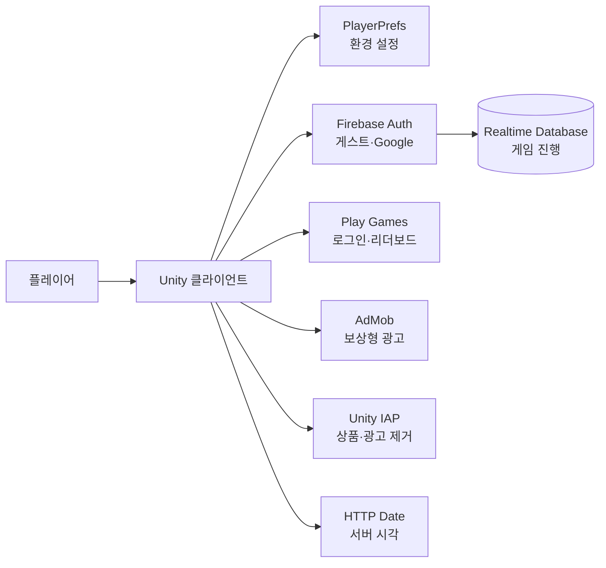

# 사제의 길: 낮과 밤

Google Play 출시와 운영 대응까지 맡은 1인 개발 방치형 RPG입니다. Unity로 전투와 성장 구조를 만들고 Firebase, Google Play Games, AdMob, 인앱 결제를 연결했습니다.

<p>
  
  
  
  
  
  
  
</p>

[Google Play](https://play.google.com/store/apps/details?id=com.KHS.MonsterRaidIdle) · [플레이 영상](https://youtu.be/jKvEW6LIzaw)


## 프로젝트 요약

| 기간 | 구성 | 담당 | 결과물 |
| --- | --- | --- | --- |
| 2025.08 출시 · 운영 중 | 1인 개발 | 기획, Unity C# 클라이언트, Firebase·Google 서비스, Play 배포 | Android v1.1.1 |


수치는 현재 공개본의 빌드 설정, 코드, 출시 검증 기록을 기준으로 적었습니다.

## 맡은 일

- 전투, 성장, 영웅·유물, 던전, 퀘스트, 오프라인 보상 구현
- 게스트·Google 로그인과 Firebase Realtime Database 저장 구조 구현
- Google Play Games 리더보드, AdMob 보상형 광고, Unity IAP 연동
- 한국어·영어·일본어 CSV 로컬라이징과 기기 언어 적용
- AAB 빌드, Google Play 등록, SDK·계정 삭제 정책 대응

## 구조와 기술 선택



| 선택 | 이유 |
| --- | --- |
| Firebase Auth + Realtime Database | 로그인 유형을 나누고 사용자 UID 기준으로 진행 데이터를 저장 |
| PlayerPrefs | BGM, 효과음, 언어처럼 기기 안에 둘 설정을 서버 데이터와 분리 |
| HTTP Date 기반 시각 | 낮·밤, 일일 초기화, 미접속 판정이 기기 시계만 따르지 않도록 시간 진입점을 통합 |
| Queue 기반 오브젝트 풀 | 전투 중 반복 생성되는 몬스터, 아이템, 코인을 회수해 다시 사용 |
| CSV 로컬라이징 | UI 코드와 문구를 분리하고 같은 키로 3개 언어를 조회 |

## 운영에서 해결한 문제

### 1. SDK를 하나씩 올리자 Android 빌드가 깨졌다

**문제.** Google Play의 Target SDK와 16KB 페이지 크기 대응 과정에서 Firebase, Google Play Games, Mobile Ads의 Android 의존성이 겹쳤습니다. 기존 Google Sign-In 플러그인까지 남아 Gradle 빌드와 인증 경로를 함께 확인해야 했습니다.

**판단.** 생성된 Gradle 파일을 고치는 방식은 다음 빌드에서 사라집니다. 인증 SDK의 책임과 버전을 Unity 프로젝트 안에서 맞추는 쪽으로 정리했습니다.

**구현.** Unity 6000.0.76f1, Target SDK 35, Firebase Unity SDK 13.12.0, Google Play Games 2.1.0, Mobile Ads 11.2.0으로 맞췄습니다. 별도 Google Sign-In 플러그인과 중복 네이티브 라이브러리를 제거하고 Play Games 인증 코드로 Firebase에 로그인하도록 변경했습니다.

**결과.** versionCode 101 AAB에서 `bundletool validate`, JAR 서명, ARM64 네이티브 라이브러리의 16KB ELF 정렬을 확인했습니다. 앱은 Google Play에서 배포 중입니다.

### 2. 회원 탈퇴 뒤 인증 계정이나 저장 데이터가 남을 수 있었다

**문제.** Firebase Auth 계정만 지우면 Realtime Database의 진행 데이터가 남고, DB만 지우면 로그인 계정이 남습니다. Google 로그인 사용자는 최근 인증이 없으면 계정 삭제 요청도 실패합니다.

**판단.** 탈퇴를 한 번의 버튼 처리로 보지 않고 재인증, 원격 데이터, 인증 계정, 로컬 데이터 순서로 나눴습니다. 앞 단계가 실패하면 다음 단계로 넘어가지 않도록 했습니다.

**구현.** Google 계정은 Play Games에서 서버 인증 코드를 다시 받아 Firebase 자격 증명으로 재인증합니다. 이후 `USER/{uid}` 삭제, Firebase Auth 계정 삭제, 로그아웃, PlayerPrefs 초기화를 순서대로 실행합니다. 앱 안의 삭제 버튼과 웹 삭제 안내 페이지도 마련했습니다.

**결과.** Google Play 데이터 보안 항목에서 데이터 삭제 요청 경로를 제공하고 있습니다.

```text
재인증 → USER/{uid} 삭제 → Auth 계정 삭제 → 로그아웃 → PlayerPrefs 초기화
```

### 3. 방치 보상과 낮·밤 판정이 기기 시간에 묶였다

**문제.** 낮·밤 전투, 일일 초기화, 미접속 보상과 캐릭터 상태가 시간 차이를 사용합니다. 기기 시계만 기준으로 잡으면 사용자가 시간을 바꾼 뒤 결과가 달라질 수 있습니다.

**판단.** 각 기능에서 시간을 따로 계산하지 않고 로그인 시 한 번 동기화한 시각을 공통으로 사용했습니다.

**구현.** 서버 응답의 HTTP `Date` 헤더와 기기 시각의 차이를 저장하고 `Timer_NTP.NowTime`으로 노출했습니다. 저장 시각, 낮·밤 판정, 미접속 캐릭터 상태가 이 값을 사용합니다. 오프라인 보상은 최대 2시간으로 제한했습니다.

**결과.** 시간 기준을 한 클래스에서 확인할 수 있고, 기기 시각에 직접 접근하는 범위를 줄였습니다.

## 출시 검증

| 대상 | 확인 내용 |
| --- | --- |
| Android App Bundle | `bundletool validate` 통과 |
| 앱 서명 | JAR 서명 검증 통과 |
| 네이티브 라이브러리 | ARM64 ELF 16KB 정렬 확인 |
| 계정 삭제 | Google 재인증, RTDB 삭제, Auth 삭제, 로컬 초기화 순서 확인 |
| 공개 설정 | Firebase 설정 파일, 광고 단위 ID, keystore, 빌드 산출물 제외 |

## 코드에서 확인할 부분

- [Google·게스트 로그인과 계정 삭제](src/Mng/Firebase/Firebase_Login.cs)
- [Realtime Database 저장과 로드](src/Mng/Firebase/Firebase_Database.cs)
- [서버 시각 동기화](src/Timer_NTP.cs)
- [보상형 광고 수명주기](src/Mng/ADS_Manager.cs)
- [인앱 결제 상품 처리](src/IAP_Manager.cs)
- [오프라인 보상 계산](src/UI/UI_Offline.cs)
- [오브젝트 풀](src/Mng/Pool_Manager.cs)
- [CSV 로컬라이징](src/Mng/Local_Manager.cs)

## 주요 화면

<table>
  <tr>
    <td width="25%"></td>
    <td width="25%"></td>
    <td width="25%"></td>
    <td width="25%"></td>
  </tr>
</table>

> 상용·외부 에셋과 빌드 산출물은 포함하지 않았습니다. 직접 작성한 C# 코드는 원본의 CP949·UTF-8 혼용을 UTF-8로 통일했고, Firebase 설정, Google 서비스 식별자, 광고 단위 ID, keystore는 공개본에서 제외했습니다.
